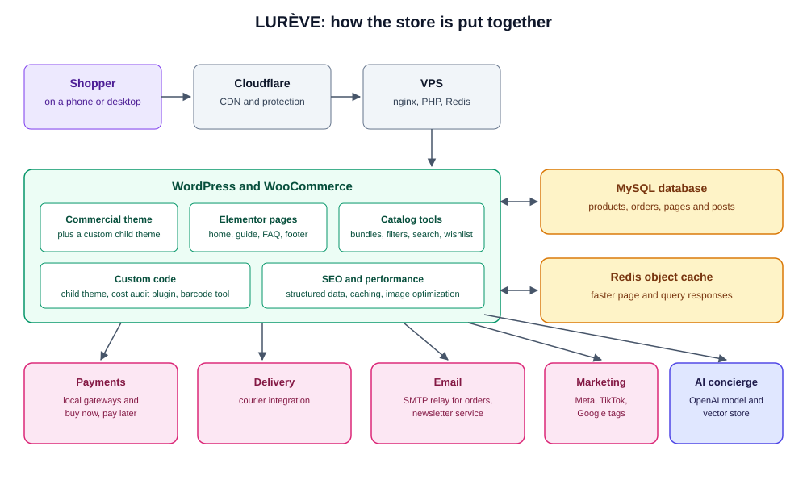
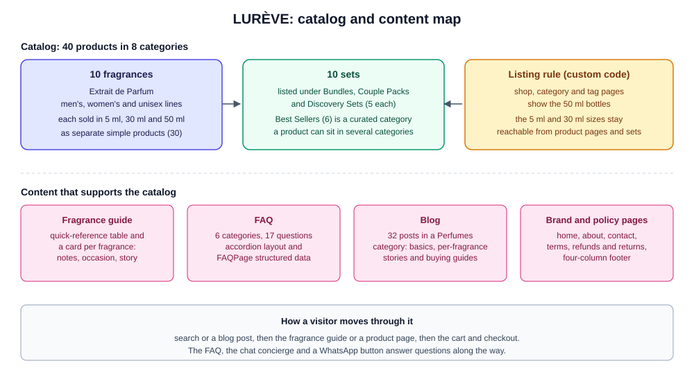

# LURÈVE

Documentation for the online store of LURÈVE, a luxury perfume brand based in Pakistan. The store sells Extrait de Parfum in three sizes, as single bottles, bundles, couple packs and discovery sets, with delivery across Pakistan. The live store is at https://lureve.pk.

> **This repository documents the work. It does not contain the store.** LURÈVE runs on WordPress and WooCommerce with commercial components, and the pages and products live in the database, so there is no single codebase to publish. The configuration files, credentials, customer and order data, business figures and tracking IDs are left out on purpose.

## What it is

A WooCommerce store built for a solo-run brand in its launch phase. The goal was a store that looks like a luxury brand, loads fast on a phone, answers customer questions without a person, and gives the owner a clear view of costs and margins.

## Architecture

- **Platform.** WordPress with WooCommerce, with high-performance order storage turned on.
- **Theme.** A commercial WooCommerce theme with a custom child theme, so the parent can update without losing changes.
- **Pages.** Built with Elementor. Product, catalog, blog and policy pages come from WooCommerce and WordPress.
- **Hosting.** A VPS running nginx, PHP and Redis, behind Cloudflare. Redis serves as a persistent object cache.
- **Integrations.** Local payment gateways including a buy-now-pay-later option, a Pakistani courier integration, SMTP email delivery, a newsletter service, ad and analytics pixels, and an AI chat concierge.

### How the catalog and content are organised

## What I built

- **Catalog.** 40 products in 8 categories. Ten fragrances, each sold as separate simple products in 5 ml, 30 ml and 50 ml (30 products), plus 10 sets, listed under Bundles, Couple Packs and Discovery Sets. A product can sit in several categories. Separate simple products were a deliberate choice over variations.
- **Custom child theme (about 170 lines of PHP and CSS).**
  - Preloads the home page hero image to improve the largest-contentful-paint time, on the front page only.
  - Hides the 5 ml and 30 ml products from shop, category and tag listings so customers see the 50 ml bottles first, while keeping them reachable from product pages and sets.
  - Removes the add-to-cart action for the products inside a bundle.
  - Adds a floating WhatsApp chat button.
  - Re-fires the add-to-cart event so ad-pixel tracking works when customers add to cart on a product page with AJAX.
- **Cost audit plugin (about 500 lines).** A custom admin plugin with its own database table. It records the landed cost of each product (oil, carrier, bottle, box) and compares it with price and margin, for all 40 products.
- **Barcode utility (about 730 lines).** An EAN-13 check-digit and barcode generator for product labelling.
- **Content.**
  - A fragrance guide page with a quick-reference table and a card per fragrance (notes, occasion, story).
  - A FAQ page with 6 categories and 17 questions, with FAQPage structured data.
  - 32 blog posts in a Perfumes category, covering fragrance basics, per-fragrance stories and buying guides.
  - About, contact, terms and refund pages, and a four-column footer with a newsletter signup.
- **AI concierge.** A website chatbot that answers from a vector store of the store's own content (retrieval-augmented generation) through an OpenAI model.
- **SEO.** Moved from one SEO plugin to another, with structured data on the FAQ page and IndexNow support for faster indexing.
- **Email.** Fixed site-wide outgoing mail by relaying through an SMTP service, so order and contact emails reach customers.
- **Performance.** Mobile PageSpeed raised from 48 to 85, with 98 on desktop, as recorded in the project log.

### Process

Each larger piece of work (the fragrance guide, the blog and the FAQ) went through a written design spec, an implementation plan and a QA pass before it shipped. The specs and plans are kept in a private repository.

## Tech stack

| Area | Tools |
|---|---|
| CMS and store | WordPress, WooCommerce |
| Page building | Elementor |
| Custom fields, bundles, product tables | ACF, product bundles, product table plugins |
| Code | PHP and CSS in a child theme and a custom plugin |
| Server | VPS with nginx, PHP, Redis object cache, Cloudflare |
| Email | SMTP relay, newsletter plugin, contact forms |
| Marketing | Meta, TikTok and Google pixels and listings, Google Tag Manager |
| AI | A chatbot plugin with an OpenAI model and vector store |

## Known limitations

- **Content lives in the database, not in git.** Pages and posts were built through an automation interface straight on the live site. There is no staging copy and no automated deploy.
- **The local copy is not synced with the live site.** A proper sync or deploy path has not been decided, and a full local development environment was never set up.
- **No automated tests.**
- **Image alt text is missing** on a little over half the site's images (157 of 280).
- **Render-blocking CSS** from the theme is not yet resolved, so there is room left in the mobile score.
- **Some placeholders remain:** the footer's social links, and stock images on the About page.
- **A typo in a category name** ("Unisex's Fragrances") is still to fix.
- **The chatbot has no usage or cost monitoring.**
- **Skincare** is part of the brand vision but is not a live product line.

## Author

Ammad Sarfraz

This repository contains documentation only.
